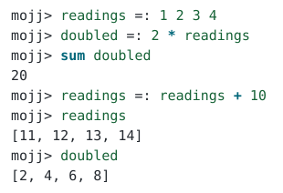
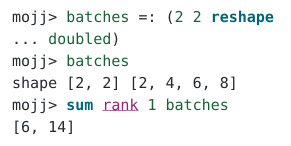
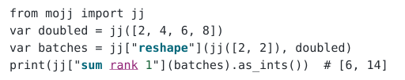
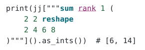

# The Mojj command line

From the repository root, run `pixi run mojj`. Type a Mojj sentence and press Enter. A sentence that produces a value prints it. An assignment saves the value for later commands in the same session.

<!-- mojj-example: cli-assignment -->


<details>
<summary>Copy the example</summary>

```text
mojj> readings =: 1 2 3 4
mojj> doubled =: 2 * readings
mojj> sum doubled
20
mojj> readings =: readings + 10
mojj> readings
[11, 12, 13, 14]
mojj> doubled
[2, 4, 6, 8]
```

</details>
<!-- /mojj-example -->

Assignment evaluates the right side once. Updating `readings` leaves the earlier value of `doubled` available. A failed assignment preserves the previous binding. Use `=:` for assignment and `=` for equality.

## Read the colors

The interactive prompt highlights each token as you type. Try `totals =: sum rank 1 readings` after assigning `readings`.

| Appearance | Role | In this sentence |
| --- | --- | --- |
| Bold cyan | Verb (an operation) | `sum` adds the items |
| Green | Noun (data or a name for data) | `readings` supplies the array, `1` the rank, and `totals` names the result |
| Underlined magenta | Modifier (changes how an operation applies) | `rank` applies `sum` to rank-1 cells |

The same colors apply to symbols. In `+/ readings`, `+` is a verb and `/` modifies it to add across the items. Names take the noun color even while you’re typing a new name. Pressing Enter evaluates the sentence and reports any undefined names.

Set `NO_COLOR=1` for plain input. Scripts, redirected output, and terminals with `TERM=dumb` also use plain text. The colors belong to the Mojj prompt started by `pixi run mojj`; the underlying Mojo REPL has its own display.

## Continue a sentence on the next line

An open parenthesis gives you a continuation prompt. Close the group and press Enter to evaluate the whole sentence. The same rule works with piped input.

<!-- mojj-example: cli-continuation -->


<details>
<summary>Copy the example</summary>

```text
mojj> batches =: (2 2 reshape
... doubled)
mojj> batches
shape [2, 2] [2, 4, 6, 8]
mojj> sum rank 1 batches
[6, 14]
```

</details>
<!-- /mojj-example -->

Higher-rank arrays display their shape followed by the elements in row-major order. Enter `:quit` to leave the session. For a script, put the same commands in a text file without the prompts and run `pixi run mojj < readings.mojj`. Errors go to standard error. A script continues after a failed sentence and exits with a nonzero status if any sentence failed.

## What runs under the hood?

The `mojj` launcher starts one `pixi run mojo repl` process with Mojj on its import path. For each command the launcher sends a Mojo cell containing the quoted phrase. Mojo compiles the phrase with Mojj’s parser and runs the same verbs used by `jj`. The running Mojo process owns the session’s noun values. Starting a new session starts with an empty set of names.

Here is the batch example directly in the **Mojo REPL**. Start it with `cd src && pixi run mojo repl` from the repository root. Submit the block with a blank line.

<!-- mojj-example: cli-mojo -->


<details>
<summary>Copy the example</summary>

```mojo
from mojj import jj
var doubled = jj([2, 4, 6, 8])
var batches = jj["reshape"](jj([2, 2]), doubled)
print(jj["sum rank 1"](batches).as_ints())  # [6, 14]
```

</details>
<!-- /mojj-example -->

Use the Mojj prompt for array calculations. Use the Mojo prompt for Mojo imports, types, functions, or mixing Mojj with other libraries. At the Mojj prompt, names inside a sentence refer to saved nouns. In ordinary Mojo code, supply runtime data through the parentheses after `jj["phrase"]`.

Mojo also accepts a triple-quoted string for a single Mojj phrase. Line breaks separate tokens just like spaces. The following complete sentence gives the same row totals.

<!-- mojj-example: cli-multiline -->


<details>
<summary>Copy the example</summary>

```mojo
print(jj["""sum rank 1 (
    2 2 reshape
    2 4 6 8
)"""]().as_ints())  # [6, 14]
```

</details>
<!-- /mojj-example -->

Session names start with an ASCII letter and can contain letters, digits, and underscores. Mojj vocabulary words are reserved. Assignment stores scalars and arrays. Write verbs directly in each sentence and use literals for operands that form a derived verb, such as the rank in `sum rank 1`. To give a verb a reusable name in Mojo, use a compile-time `Expr` as shown in the [words walkthrough](WORDS.md#run-it-as-a-program). Each input phrase has the library’s usual [syntax limits](SYNTAX.md).
