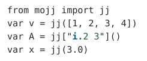
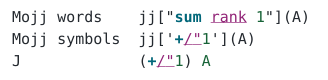
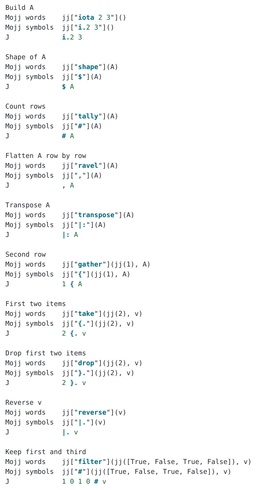
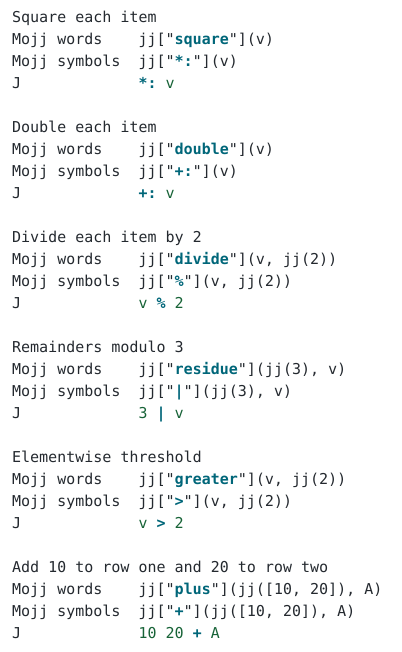
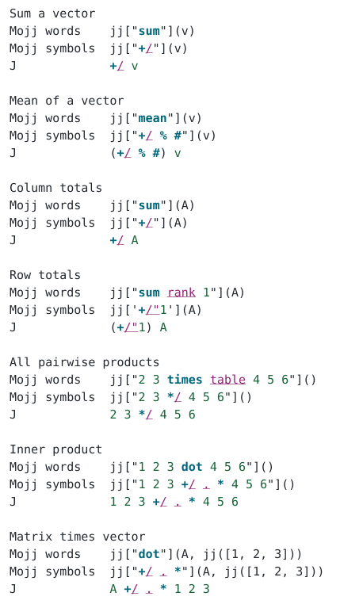
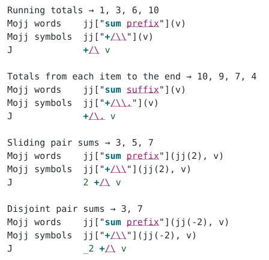
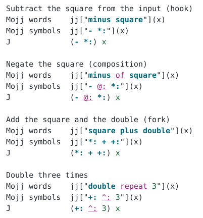
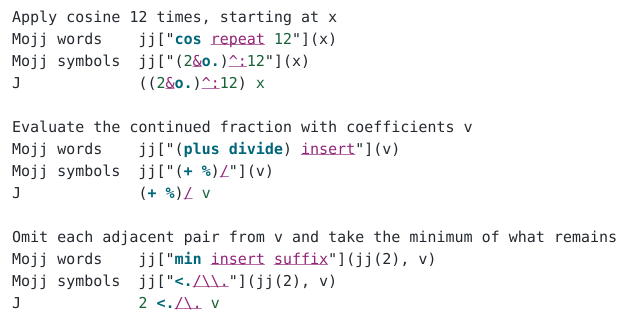
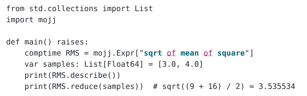
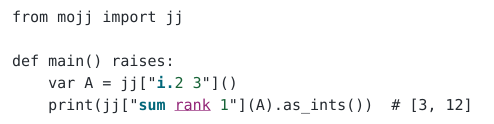

# Mojj by example

For a guided introduction using the word spellings, start with [Learn Mojj with words](WORDS.md).

`jj(x)` turns Mojo data into a Mojj **noun** (a scalar or array). For example, `jj(3)` wraps one integer and `jj([2, 4])` wraps a vector. Use `jj["…"](...)` when you have a **phrase** to evaluate. The brackets hold the code. The number of arguments in parentheses tells you how to read it.

- **Zero** · `jj["10 - 3"]()` evaluates a complete sentence → `7`.
- **One** · `jj["-"](jj(3))` applies the monad (negate) → `-3`.
- **Two** · `jj["-"](jj(10), jj(3))` applies the dyad (subtract right from left) → `7`.

Each call returns a noun, so you can pass its result straight into another call. If you prefer explicit names, import `Noun` and `Expr` from `mojj`. Write `Noun(x)` for an `Int`, `Float64`, `Bool`, or a list of any one of those types. For a phrase, spell the three calls `Expr[phrase].value()`, `Expr[phrase].monad(y)`, and `Expr[phrase].dyad(x, y)`.

Read the colors as parts of speech. In `sum rank 1`, **sum** is a verb (bold cyan), **rank** modifies it (underlined magenta), and **1** is a noun (green). On GitHub, expand **Read the Mojj and J expressions in color** beneath any recipe table. For color directly in the table cells, run `pixi run docs` and open `build/docs/docs/SHOWCASE.html`.

## Try it in the Mojo REPL

Start the REPL from the repository’s `src` directory so it can import Mojj.

```sh
cd src && pixi run mojo repl
```

Paste this block and press Enter on a blank line. The variables stay available for all the tables.

<!-- mojj-example: showcase-setup -->


<details>
<summary>Copy the example</summary>

```mojo
from mojj import jj
var v = jj([1, 2, 3, 4])
var A = jj["i.2 3"]()
var x = jj(3.0)
```

</details>
<!-- /mojj-example -->

Try `print(jj["sum rank 1"](A).as_ints())` and submit another blank line. The result is `[3, 12]`. Enter `:quit` at a fresh prompt to exit. For the same example in a file, see [Run as a Mojo program](#run-as-a-mojo-program).

How do you sum each row of a matrix? In NumPy and NuMojo you choose an axis. In MATLAB you choose a dimension. In J and Mojj you can choose the **cell** that gets passed to the verb. For the matrix with rows `0 1 2` and `3 4 5`, these all give row totals of 3 and 12.

| NumPy | MATLAB | NuMojo | Mojj words | Mojj symbols | J |
| --- | --- | --- | --- | --- | --- |
| `A.sum(axis=1)` | `sum(A,2)` | `nm.sum(A, axis=1)` | `jj["sum rank 1"](A)` | `jj['+/"1'](A)` | `(+/"1) A` |

<!-- mojj-comparison: showcase-row-totals -->
<details open>
<summary>Read the Mojj and J expressions in color</summary>



</details>
<!-- /mojj-comparison -->

The `1` in `rank 1` means “give sum a vector.” Each row is one trailing vector, so the result has one total per row. To add the rows together, drop the rank modifier. That result is the three column totals `3 5 7`.

[Build and select arrays](#build-and-select-arrays) · [Calculate and compare](#calculate-and-compare) · [Reduce and combine](#reduce-and-combine) · [Windows and blocks](#windows-and-blocks) · [Compose a calculation](#compose-a-calculation) · [Replace a loop or callback](#replace-a-loop-or-callback) · [Use runtime data](#use-runtime-data) · [Where J and Mojj differ](#where-j-and-mojj-differ)

## Set up the other columns

**NumPy**

```python
from functools import reduce
import numpy as np
v = np.array([1, 2, 3, 4])
A = np.arange(6).reshape(2, 3)
x = 3.0
```

**MATLAB**

```matlab
v = [1 2 3 4];
A = reshape(0:5,3,2).';
x = 3.0;
```

**NuMojo (Mojo REPL)**

Use NuMojo v0.11.0 for Mojo 1.1.0. In a separate directory, start a session from the tagged source checkout. [NuMojo v0.11.0](https://github.com/Mojo-Numerics-and-Algorithms-group/NuMojo/tree/v0.11.0)

```sh
git clone --branch v0.11.0 --depth 1 https://github.com/Mojo-Numerics-and-Algorithms-group/NuMojo.git
cd NuMojo
pixi run --locked mojo repl
```

```mojo
import numojo as nm
from numojo.prelude import Item, Shape, f64, i64
from std.math import cos, sqrt

var v = nm.array[i64]("[1, 2, 3, 4]")
var A = nm.arange[i64](6).reshape(Shape(2, 3))
var x = 3.0
```

Here `v` and `A` are integer NDArrays. `nm.array[i64]` reads the elements and shape from the bracketed string. The scalar `x` uses ordinary Mojo arithmetic and the standard-library `cos`.

**J**

```j
v =: 1 2 3 4
A =: i.2 3
x =: 3.0
```

MATLAB's `v` is a row vector. NuMojo, NumPy, Mojj, and J use a one-dimensional vector. Each column keeps its native indexing and shape conventions.

## Build and select arrays

| Task | NumPy | MATLAB | NuMojo | Mojj words | Mojj symbols | J |
| --- | --- | --- | --- | --- | --- | --- |
| Build A | `np.arange(6).reshape(2,3)` | `reshape(0:5,3,2).'` | `nm.arange[i64](6).reshape(Shape(2, 3))` | `jj["iota 2 3"]()` | `jj["i.2 3"]()` | `i.2 3` |
| Shape of A | `A.shape` | `size(A)` | `A.shape` | `jj["shape"](A)` | `jj["$"](A)` | `$ A` |
| Count rows | `len(A)` | `size(A,1)` | `A.shape[0]` | `jj["tally"](A)` | `jj["#"](A)` | `# A` |
| Flatten A row by row | `A.ravel()` | `reshape(A.',1,[])` | `nm.ravel(A)` | `jj["ravel"](A)` | `jj[","](A)` | `, A` |
| Transpose A | `A.T` | `A.'` | `A.T()` | `jj["transpose"](A)` | `jj["\|:"](A)` | `\|: A` |
| Second row | `A[1]` | `A(2,:)` | `A[1]` | `jj["gather"](jj(1), A)` | `jj["{"](jj(1), A)` | `1 { A` |
| First two items | `v[:2]` | `v(1:2)` | `v[:2]` | `jj["take"](jj(2), v)` | `jj["{."](jj(2), v)` | `2 {. v` |
| Drop first two items | `v[2:]` | `v(3:end)` | `v[2:]` | `jj["drop"](jj(2), v)` | `jj["}."](jj(2), v)` | `2 }. v` |
| Reverse v | `v[::-1]` | `fliplr(v)` | `nm.flip(v)` | `jj["reverse"](v)` | `jj["\|."](v)` | `\|. v` |
| Keep first and third | `v[[True,False,True,False]]` | `v(logical([1 0 1 0]))` | `v[List[Bool]([True, False, True, False])]` | `jj["filter"](jj([True, False, True, False]), v)` | `jj["#"](jj([True, False, True, False]), v)` | `1 0 1 0 # v` |

<!-- mojj-comparison: showcase-arrays -->
<details>
<summary>Read the Mojj and J expressions in color</summary>



</details>
<!-- /mojj-comparison -->

Mojj gathers along the leading axis using zero-based indices. Its reshape cycles the source items when it needs more data. For example, `2 3 reshape 1 2` gives rows `1 2 1` and `2 1 2`. NumPy and MATLAB reshape require matching element counts. Mojj take can also extend a vector with fill values.

## Calculate and compare

| Task | NumPy | MATLAB | NuMojo | Mojj words | Mojj symbols | J |
| --- | --- | --- | --- | --- | --- | --- |
| Square each item | `v**2` | `v.^2` | `v**2` | `jj["square"](v)` | `jj["*:"](v)` | `*: v` |
| Double each item | `2*v` | `2*v` | `2*v` | `jj["double"](v)` | `jj["+:"](v)` | `+: v` |
| Divide each item by 2 | `v/2` | `v./2` | `v.astype[f64]()/2` | `jj["divide"](v, jj(2))` | `jj["%"](v, jj(2))` | `v % 2` |
| Remainders modulo 3 | `v % 3` | `mod(v,3)` | `v % 3` | `jj["residue"](jj(3), v)` | `jj["\|"](jj(3), v)` | `3 \| v` |
| Elementwise threshold | `v > 2` | `v > 2` | `v > 2` | `jj["greater"](v, jj(2))` | `jj[">"](v, jj(2))` | `v > 2` |
| Add 10 to row one and 20 to row two | `np.array([[10],[20]]) + A` | `[10;20] + A` | `nm.array[i64]("[[10],[20]]") + A` | `jj["plus"](jj([10, 20]), A)` | `jj["+"](jj([10, 20]), A)` | `10 20 + A` |

<!-- mojj-comparison: showcase-arithmetic -->
<details>
<summary>Read the Mojj and J expressions in color</summary>



</details>
<!-- /mojj-comparison -->

Read the last row as “pair each left item with one right row.” Mojj matches **leading** dimensions. The result has rows `10 11 12` and `23 24 25`. NumPy aligns trailing dimensions, so a bare length-two vector would fail against this matrix. A Mojj length-three vector would also fail, even though the matrix has three columns.

## Reduce and combine

| Task | NumPy | MATLAB | NuMojo | Mojj words | Mojj symbols | J |
| --- | --- | --- | --- | --- | --- | --- |
| Sum a vector | `v.sum()` | `sum(v)` | `nm.sum(v)` | `jj["sum"](v)` | `jj["+/"](v)` | `+/ v` |
| Mean of a vector | `v.mean()` | `mean(v)` | `nm.mean(v)` | `jj["mean"](v)` | `jj["+/ % #"](v)` | `(+/ % #) v` |
| Column totals | `A.sum(axis=0)` | `sum(A,1)` | `nm.sum(A, axis=0)` | `jj["sum"](A)` | `jj["+/"](A)` | `+/ A` |
| Row totals | `A.sum(axis=1)` | `sum(A,2)` | `nm.sum(A, axis=1)` | `jj["sum rank 1"](A)` | `jj['+/"1'](A)` | `(+/"1) A` |
| All pairwise products | `np.outer([2,3],[4,5,6])` | `[2;3]*[4 5 6]` | `nm.outer(nm.array[i64]("[2,3]"), nm.array[i64]("[4,5,6]"))` | `jj["2 3 times table 4 5 6"]()` | `jj["2 3 */ 4 5 6"]()` | `2 3 */ 4 5 6` |
| Inner product | `np.dot([1,2,3],[4,5,6])` | `dot([1 2 3],[4 5 6])` | `nm.dot(nm.array[i64]("[1,2,3]"), nm.array[i64]("[4,5,6]"))` | `jj["1 2 3 dot 4 5 6"]()` | `jj["1 2 3 +/ . * 4 5 6"]()` | `1 2 3 +/ . * 4 5 6` |
| Matrix times vector | `A @ np.array([1,2,3])` | `A*[1;2;3]` | `A @ nm.array[i64]("[1,2,3]")` | `jj["dot"](A, jj([1, 2, 3]))` | `jj["+/ . *"](A, jj([1, 2, 3]))` | `A +/ . * 1 2 3` |

<!-- mojj-comparison: showcase-reductions -->
<details>
<summary>Read the Mojj and J expressions in color</summary>



</details>
<!-- /mojj-comparison -->

For the last row the two inner products are `0×1 + 1×2 + 2×3 = 8` and `3×1 + 4×2 + 5×3 = 26`. MATLAB returns a column. Mojj returns a length-two vector. Table keeps both axes, so its two-by-three result above contains six separate products.

Insertion groups from the right. For example, `minus insert 10 3 2` means `10 - (3 - 2)`, giving 9. The same order matters for floating-point sums. Derived Mojj mean returns zero on an empty vector, whereas NumPy and MATLAB return NaN for their empty vector means.

## Windows and blocks

Each example changes which items the **same sum** sees. A positive left argument to prefix selects sliding windows; a negative one selects disjoint blocks and retains a short final block.

| Task and result | NumPy | MATLAB | NuMojo | Mojj words | Mojj symbols | J |
| --- | --- | --- | --- | --- | --- | --- |
| Running totals → 1, 3, 6, 10 | `np.cumsum(v)` | `cumsum(v)` | `nm.cumsum(v)` | `jj["sum prefix"](v)` | `jj["+/\\"](v)` | `+/\ v` |
| Totals from each item to the end → 10, 9, 7, 4 | `np.cumsum(v[::-1])[::-1]` | `flip(cumsum(flip(v)))` | `nm.flip(nm.cumsum(nm.flip(v)))` | `jj["sum suffix"](v)` | `jj["+/\\."](v)` | `+/\. v` |
| Sliding pair sums → 3, 5, 7 | `np.lib.stride_tricks.sliding_window_view(v,2).sum(axis=1)` | `conv(v,ones(1,2),'valid')` | `v[:-1] + v[1:]` | `jj["sum prefix"](jj(2), v)` | `jj["+/\\"](jj(2), v)` | `2 +/\ v` |
| Disjoint pair sums → 3, 7 | `v.reshape(-1,2).sum(axis=1)` | `sum(reshape(v,2,[]),1)` | `nm.sum(v.reshape(Shape(v.size//2, 2)), axis=1)` | `jj["sum prefix"](jj(-2), v)` | `jj["+/\\"](jj(-2), v)` | `_2 +/\ v` |

<!-- mojj-comparison: showcase-windows -->
<details>
<summary>Read the Mojj and J expressions in color</summary>



</details>
<!-- /mojj-comparison -->

The reshape idioms in the last row require an even length. Append a fifth value of 5 and Mojj returns `3 7 5`. In a Mojo string literal, escape each window backslash as `\\`, or use the word spelling directly.

## Compose a calculation

Every column applies its calculation to the scalar `x`. In J, parentheses group the verb before it acts on `x`. In Mojo, the parentheses in `jj["…"](x)` supply the same input.

| Intent | At x = 3 | NumPy | MATLAB | NuMojo | Mojj words | Mojj symbols | J |
| --- | ---: | --- | --- | --- | --- | --- | --- |
| Subtract the square from the input (hook) | −6 | `x-x**2` | `x-x.^2` | `x-x**2` | `jj["minus square"](x)` | `jj["- *:"](x)` | `(- *:) x` |
| Negate the square (composition) | −9 | `-(x**2)` | `-(x.^2)` | `-(x**2)` | `jj["minus of square"](x)` | `jj["- @: *:"](x)` | `(- @: *:) x` |
| Add the square and the double (fork) | 15 | `x**2+2*x` | `x.^2+2*x` | `x**2+2*x` | `jj["square plus double"](x)` | `jj["*: + +:"](x)` | `(*: + +:) x` |
| Double three times | 24 | `2**3*x` | `2^3*x` | `2**3*x` | `jj["double repeat 3"](x)` | `jj["+: ^: 3"](x)` | `(+: ^: 3) x` |

<!-- mojj-comparison: showcase-composition -->
<details>
<summary>Read the Mojj and J expressions in color</summary>



</details>
<!-- /mojj-comparison -->

A hook supplies the original input to the left verb. A fork sends the input down both branches and combines their results with the middle verb. In a noun sentence, evaluation proceeds from the right, so `10 divide 3 plus 2` gives 2. Parentheses let you choose a different grouping.

## Replace a loop or callback

Each library has a running sum. What if each step takes the cosine of the **previous result**, or the statistic needs the values **outside** a moving window? In J and Mojj a modifier tells a verb which inputs to visit and in what order. Here are three such recipes using the same `x` and `v` as above.

| Task | NumPy | MATLAB | NuMojo | Mojj words | Mojj symbols | J |
| --- | --- | --- | --- | --- | --- | --- |
| Apply cosine 12 times, starting at `x` | `r = x`<br>`for _ in range(12): r = np.cos(r)` | `r = x; for k = 1:12, r = cos(r); end` | `var r = x`<br>`for _ in range(12): r = cos(r)` | `jj["cos repeat 12"](x)` | `jj["(2&o.)^:12"](x)` | `((2&o.)^:12) x` |
| Evaluate the continued fraction with coefficients `v` | `reduce(lambda tail, a: a + 1/tail, v[::-1])` | `r = v(end); for a = v(end-1:-1:1), r = a + 1/r; end` | `var r = Float64(v.item(-1))`<br>`for i in range(v.size-2, -1, -1): r = Float64(v.item(i)) + 1/r` | `jj["(plus divide) insert"](v)` | `jj["(+ %)/"](v)` | `(+ %)/ v` |
| Omit each adjacent pair from `v` and take the minimum of what remains | `np.array([np.delete(v, slice(i,i+2)).min() for i in range(len(v)-1)])` | `arrayfun(@(i) min([v(1:i-1), v(i+2:end)]), 1:numel(v)-1)` | `var r = nm.zeros[i64](Shape(v.size-1))`<br>`for i in range(r.size): r[Item(i)] = nm.min(nm.delete(v, List[Int]([i, i+1])))` | `jj["min insert suffix"](jj(2), v)` | `jj["<./\\."](jj(2), v)` | `2 <./\. v` |

<!-- mojj-comparison: showcase-loop-recipes -->
<details>
<summary>Read the Mojj and J expressions in color</summary>



</details>
<!-- /mojj-comparison -->

- **Repetition** feeds each result back into cosine. From `x = 3.0`, twelve steps give approximately `0.7357345683`. J’s `2&o.` selects cosine. Mojj accepts both that spelling and `cos`.
- **Insertion** groups from the right. The two-verb hook `(+ %)` combines a coefficient and a tail as `a + 1/tail`. For `1 2 3 4`, the fraction is `1 + 1/(2 + 1/(3 + 1/4)) = 43/30`. Python’s `reduce` visits left to right, so it receives the reversed vector.
- **Outfix** (dyadic `\.`) passes the complement of each window to the verb. Omitting pairs from `1 2 3 4` leaves `3 4`, then `1 4`, then `1 2`. Their minima are `3 1 1`. Replace `min insert` with `max insert` to ask for the maxima over the same selections.

## Use runtime data

For a sensor trace, root mean square turns several readings into one magnitude. For a vector named `samples`, NumPy spells it `np.sqrt(np.mean(samples**2))`, MATLAB spells it `sqrt(mean(samples.^2))`, and NuMojo spells it `sqrt(nm.mean(samples**2))`. Name the Mojj calculation once and inspect or reuse it at different input lengths.

<!-- mojj-example: showcase-runtime -->


<details>
<summary>Copy the example</summary>

```mojo
from std.collections import List
import mojj

def main() raises:
    comptime RMS = mojj.Expr["sqrt of mean of square"]
    var samples: List[Float64] = [3.0, 4.0]
    print(RMS.describe())
    print(RMS.reduce(samples))  # sqrt((9 + 16) / 2) ≈ 3.535534
```

</details>
<!-- /mojj-example -->

| What you have | What you need | Mojj entry point |
| --- | --- | --- |
| Mojo scalar or list | Wrap a runtime value as a noun | `jj(data)` |
| One or two nouns | Apply a verb to one or two nouns | `jj[phrase](y)` or `jj[phrase](x, y)` |
| Float64 list and a strided selection | Read selected samples through a borrow | `mojj.StridedView(data, start, count, stride)` |
| Two statistics over the same expensive transform | Apply the transform once per selected item | `mojj.SharedReduce[LeftFold, RightFold, Transform]` |

A named `Expr` provides `.describe()` and the Float64 convenience methods `.apply()`, `.map()`, and `.reduce()`, as in the RMS example.

For example, set `selected = mojj.StridedView(data, 0, 2, 2)` on readings `[2., 10., 4.]`. The view selects 2 and 4. With `mojj.SharedReduce[mojj.SumFold[], mojj.MeanFold[mojj.Square], mojj.Add[1]]`, the shared transform produces 3 and 5. The first fold sums to 8 and the second averages 9 and 25 to give 17. The [typed example](../README.md#current-contract) shows the complete call. Typed `mojj.Mean[]` accumulates left to right and requires nonempty input.

Mojj compiles literal phrases over Boolean, Int64 and Float64 nouns. For checked overflow, unsupported complex results, empty frames, and the supported valences of each verb, see the [compatibility ledger](COMPATIBILITY.md) and [syntax guide](SYNTAX.md). The comparison format takes inspiration from [NumPy for MATLAB users](https://numpy.org/doc/stable/user/numpy-for-matlab-users.html).

## Where J and Mojj differ

For every recipe above, J 9.6.3 and Mojj produced the same values, shapes, and numeric types on the inputs shown. Result storage and supported domains can differ even for a short expression. These examples use the same source text in J 9.6.3 and in a Mojj noun sentence. In the last two rows, `i.0` supplies an empty integer vector.

| Expression | Mojj | J |
| --- | --- | --- |
| `%: _1` | Raises a real-domain error. | Returns the complex atom `0j1`, the square root of −1. |
| `9223372036854775807 + 1` | Raises an integer overflow error. | Promotes the result to floating point. |
| `+/ i.0` | Returns Int64 0. | Returns Boolean 0, the empty sum. |
| `*/ i.0` | Returns Int64 1. | Returns Boolean 1, the empty product. |

For a reusable named verb, J accepts `rms =: %: @: (+/ % #) @: *:`, then `rms samples` for a vector named `samples`. In Mojj the binding lives in Mojo. Write `comptime RMS = mojj.Expr["%: @: (+/ % #) @: *:"]`, then `RMS.reduce(samples)`. The phrase itself is compiled from a string literal. When porting a larger J program, check the supported valences too. For instance, the dot recipes here use two arguments. Mojj omits the determinant monad. See the [compatibility ledger](COMPATIBILITY.md) and [pinned J comparison](../tests/reference/README.md).

## Run as a Mojo program

Save this as `rows.mojo` in the repository root. It uses the same matrix and expression as the REPL example.

<!-- mojj-example: showcase-program -->


<details>
<summary>Copy the example</summary>

```mojo
from mojj import jj

def main() raises:
    var A = jj["i.2 3"]()
    print(jj["sum rank 1"](A).as_ints())  # [3, 12]
```

</details>
<!-- /mojj-example -->

Run `pixi run mojo run -I src rows.mojo` from the repository root. The `-I src` option makes the local Mojj package available to the compiler.
