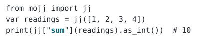
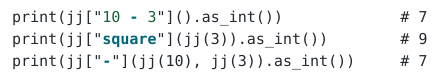
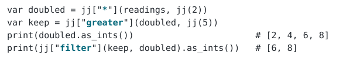
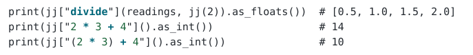
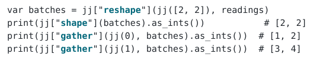
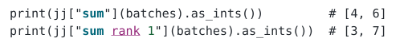
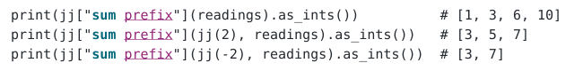
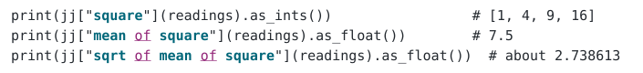
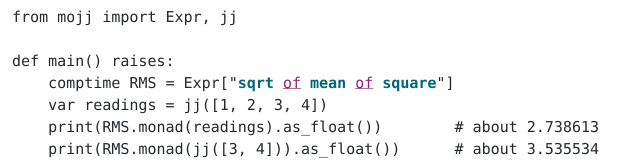

# Learn Mojj with words

Start with four readings. By the end of this walkthrough, you’ll have used the same readings to select a subset, total batches, slide a window, and build a reusable root mean square calculation.

Inside the phrase quotes, look for operations in bold cyan, data in green, and modifiers in underlined magenta. On GitHub, expand **Copy the example** beneath each illustration for the source.

From the repository root, start the Mojo REPL. Paste each Mojo block in order and press Enter on a blank line to run it. For a complete source file, see [Run it as a program](#run-it-as-a-program).

```sh
cd src && pixi run mojo repl
```

<!-- mojj-example: words-first-sum -->


<details>
<summary>Copy the example</summary>

```mojo
from mojj import jj
var readings = jj([1, 2, 3, 4])
print(jj["sum"](readings).as_int())  # 10
```

</details>
<!-- /mojj-example -->

`jj(data)` wraps Mojo data as a **noun**, Mojj’s name for a scalar or array. `jj["sum"]` names a calculation. The parentheses after the brackets run it, and their argument count tells you how to read it.

<!-- mojj-example: words-valence -->


<details>
<summary>Copy the example</summary>

```mojo
print(jj["10 - 3"]().as_int())             # 7
print(jj["square"](jj(3)).as_int())        # 9
print(jj["-"](jj(10), jj(3)).as_int())     # 7
```

</details>
<!-- /mojj-example -->

With zero arguments the phrase supplies its own data. With one argument the verb acts on that input (a **monad**). With two it takes a left and a right input (a **dyad**). Every call returns a noun. Keep it in that form to feed another verb, and use accessors like `.as_int()` or `.as_ints()` when you want a Mojo value to print. The explicit forms are `Noun(data)`, `Expr[phrase].value()`, `Expr[phrase].monad(y)`, and `Expr[phrase].dyad(x, y)`.

## Work with the readings

A scalar paired with a vector acts on each item. To double the readings and then keep only values above five, build a mask and pass it to `filter`.

<!-- mojj-example: words-filter -->


<details>
<summary>Copy the example</summary>

```mojo
var doubled = jj["*"](readings, jj(2))
var keep = jj["greater"](doubled, jj(5))
print(doubled.as_ints())                       # [2, 4, 6, 8]
print(jj["filter"](keep, doubled).as_ints())   # [6, 8]
```

</details>
<!-- /mojj-example -->

For two-input arithmetic, `+`, `-`, and `*` mean add, subtract, and multiply. Write `divide` for division. In a Mojj phrase, `/` is a modifier. Inside a phrase, Mojj evaluates from right to left. Parenthesize a step when its grouping matters.

<!-- mojj-example: words-arithmetic -->


<details>
<summary>Copy the example</summary>

```mojo
print(jj["divide"](readings, jj(2)).as_floats())  # [0.5, 1.0, 1.5, 2.0]
print(jj["2 * 3 + 4"]().as_int())                 # 14
print(jj["(2 * 3) + 4"]().as_int())               # 10
```

</details>
<!-- /mojj-example -->

## Split the readings into batches

Treat the first two readings as one batch and the last two as another. Give `reshape` the dimensions on the left and the data on the right. Row indices start at zero.

<!-- mojj-example: words-shape -->


<details>
<summary>Copy the example</summary>

```mojo
var batches = jj["reshape"](jj([2, 2]), readings)
print(jj["shape"](batches).as_ints())           # [2, 2]
print(jj["gather"](jj(0), batches).as_ints())  # [1, 2]
print(jj["gather"](jj(1), batches).as_ints())  # [3, 4]
```

</details>
<!-- /mojj-example -->

Which total do you want? Plain `sum` adds the two rows together, giving one total for each position in a batch. To total each batch separately, write `sum rank 1`. The `1` tells Mojj to give `sum` one vector at a time. In a matrix, each row is such a vector.

<!-- mojj-example: words-rank -->


<details>
<summary>Copy the example</summary>

```mojo
print(jj["sum"](batches).as_ints())         # [4, 6]
print(jj["sum rank 1"](batches).as_ints())  # [3, 7]
```

</details>
<!-- /mojj-example -->

## Slide a window

Go back to the original sequence. With one argument, `sum prefix` totals successively longer prefixes. Supply a window length on the left and the same phrase totals each window instead.

<!-- mojj-example: words-windows -->


<details>
<summary>Copy the example</summary>

```mojo
print(jj["sum prefix"](readings).as_ints())          # [1, 3, 6, 10]
print(jj["sum prefix"](jj(2), readings).as_ints())   # [3, 5, 7]
print(jj["sum prefix"](jj(-2), readings).as_ints())  # [3, 7]
```

</details>
<!-- /mojj-example -->

A positive width slides one item at a time, so the middle window contains 2 and 3. A negative width takes disjoint blocks, so the two totals agree with the batch totals above.

What if you want to **exclude** each pair and find the lowest reading left? `min insert` takes the minimum of a group. Adding `suffix` and supplying a width makes that group everything outside each window.

<!-- mojj-example: words-suffix -->


<details>
<summary>Copy the example</summary>

```mojo
print(jj["min insert suffix"](jj(2), readings).as_ints())  # [3, 1, 1]
```

</details>
<!-- /mojj-example -->

For the first window, removing 1 and 2 leaves 3 and 4, whose minimum is 3. Slide once and the remaining readings are 1 and 4. The final window leaves 1 and 2.

## Build a statistic

The root mean square (RMS) of the readings is the square root of their mean square. Write that definition almost as you would say it. The word `of` composes verbs, so the rightmost step runs first.

<!-- mojj-example: words-rms -->


<details>
<summary>Copy the example</summary>

```mojo
print(jj["square"](readings).as_ints())                 # [1, 4, 9, 16]
print(jj["mean of square"](readings).as_float())        # 7.5
print(jj["sqrt of mean of square"](readings).as_float())  # about 2.738613
```

</details>
<!-- /mojj-example -->

## Run it as a program

To reuse the phrase, give it a compile-time name with `Expr`. Its `.monad()` method applies it to one noun. Save this as `readings.mojo` in the repository root, then run `pixi run mojo run -I src readings.mojo` from that directory.

<!-- mojj-example: words-program -->


<details>
<summary>Copy the example</summary>

```mojo
from mojj import Expr, jj

def main() raises:
    comptime RMS = Expr["sqrt of mean of square"]
    var readings = jj([1, 2, 3, 4])
    print(RMS.monad(readings).as_float())        # about 2.738613
    print(RMS.monad(jj([3, 4])).as_float())      # about 3.535534
```

</details>
<!-- /mojj-example -->

Explore more operations in the [syntax guide](SYNTAX.md), or find equivalent recipes in the [side-by-side showcase](SHOWCASE.md).
